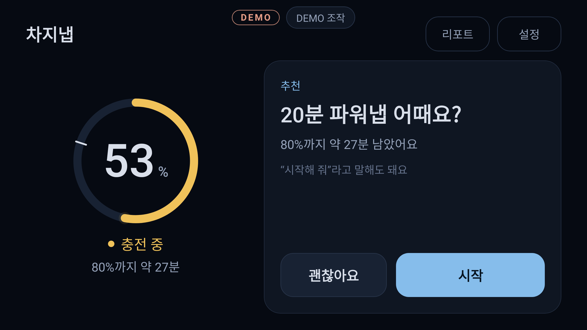
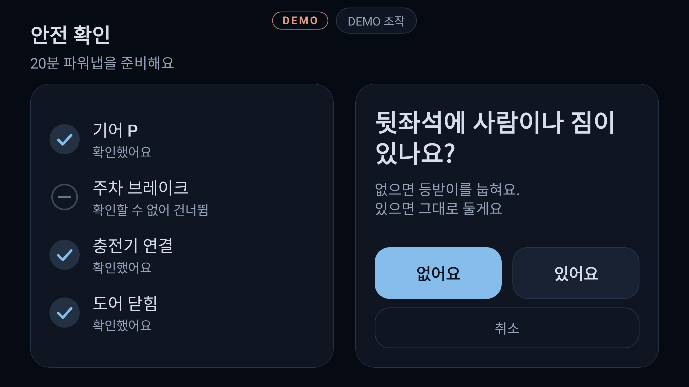
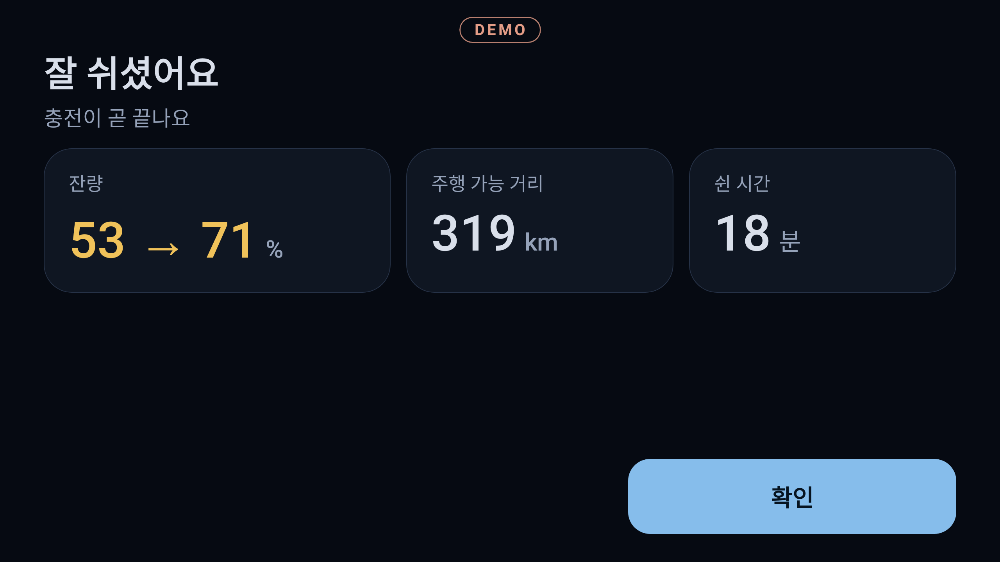

# 차지냅 (ChargeNap)

**차가 충전되는 동안, 나도 충전.**
전기차 급속 충전 시간에 맞춰 시트와 공조를 세팅하고, 충전이 끝나기 전에 깨워 주는 Pleos Connect용 파워냅 앱입니다.

현대자동차그룹 차량용 앱 개발 공모전 출품작입니다.

| | |
| --- | --- |
|  |  |
|  |  |

화면 이미지는 앱의 Compose 화면을 2,560×1,440으로 렌더링한 단위 테스트 스냅샷입니다(`docs/screenshots/`, 31장).

## 무엇을 하나요

1. 충전 시작과 기어 P를 감지하면 "80%까지 약 27분 남았어요. 20분 파워냅 어때요?"라고 먼저 제안합니다.
2. 음성("20분만 재워줘") 또는 터치로 수락합니다.
3. 기어·충전·도어를 확인하고, 뒷좌석에 사람이나 짐이 있는지 묻습니다. "없어요"라고 답해야 시트를 움직입니다.
4. 현재 시트·공조 상태를 저장한 뒤 등받이를 눕히고 수면용 온도·풍량으로 바꿉니다. 화면은 어두워집니다.
5. 호흡 안내 뒤 백색소음으로 넘어가고, 충전 상태를 계속 지켜봅니다.
6. 타이머 종료와 "충전 완료 5분 전" 중 먼저 오는 시점에 깨웁니다. 서늘한 바람 → 시트 복귀 → 음성 브리핑 순서입니다.
7. 세션을 기록해 주간 휴식 리포트로 보여 줍니다.

도어가 열리면 시트를 멈추고 세션을 중단하며, 기어가 P를 벗어나면 즉시 중단하고 시트·공조를 되돌립니다.

## APK 파일 위치

`apk/TeamChargeNap_ChargeNap_release.apk` (release, 서명됨, 약 42MB)

> 파일명의 팀명은 `gradle.properties`의 `chargenap.teamName` 값입니다. 바꾸려면 `scripts/package-release.sh <팀명>`.

## 실행 방법

### 설치해서 실행

```bash
adb install -r apk/TeamChargeNap_ChargeNap_release.apk
adb shell am start -n com.chargenap.app/.MainActivity
```

- **Pleos Connect 에뮬레이터**에서는 실제 차량 서비스(Vehicle Service)에 연결해 동작합니다.
- Vehicle Service가 없는 기기(일반 에뮬레이터 등)에서는 자동으로 **데모 모드(가상 차량)** 로 실행되고 화면 상단에 `DEMO` 배지가 뜹니다.
- 설정 화면에서 데모 모드를 직접 켤 수도 있습니다. 데모 모드는 60배속이라 20분 세션이 20초에 재생되고, 화면 위쪽 "DEMO 조작" 패널로 충전 중단·도어 열림·기어 변경을 재현할 수 있습니다. 가상 충전이 끝난 뒤 패널의 [충전 시작]을 누르면 52%부터 새 충전이 시작되어 앱을 다시 켜지 않고도 시연을 반복할 수 있습니다.

### 소스에서 빌드

```bash
scripts/bootstrap-toolchain.sh     # JDK 17, Android SDK를 홈 디렉터리에 설치 (sudo 불필요, 이미 있으면 생략)
source scripts/env.sh
./gradlew assembleDebug            # 디버그 APK
./gradlew testDebugUnitTest        # 단위 테스트 391개
scripts/package-release.sh         # 서명된 release APK → apk/
```

release 빌드에는 저장소 루트의 `keystore.properties`(커밋하지 않음)가 필요합니다. 없으면 스크립트가 만드는 방법을 안내합니다.

### 에뮬레이터에서 차량 상황 재현 (실제 SDK 경로)

```bash
scripts/install-pleos-emulator.sh  # Pleos Connect 시스템 이미지 설치 + AVD "PleosConnect" 생성
scripts/run-emulator.sh            # cold boot로 실행
adb forward tcp:8088 tcp:8088      # 브라우저에서 http://127.0.0.1:8088/ → Virtual Console
```

Virtual Console에서 **Gear Selection = P, Charge Switch = On**으로 두고 **Battery SOC**를 조금씩 올리면 충전으로 인식해 제안이 뜹니다. Door Position을 열거나 Gear를 D로 바꾸면 세션이 중단됩니다.

## 테스트 환경과 필요한 설정

| 항목 | 값 |
| --- | --- |
| Pleos Connect 에뮬레이터 | **Pleos Connect Emulator 2.1.0** (`system-images;android-34;pleos_car_emulator;x86_64`) |
| Android 버전 | Android 14 (API 34) |
| 화면 규격 | **2,560 × 1,440 px, 가로, 160dpi** (에뮬레이터 기기 정의 "Pleos Connect v2.1.0", 12.8인치) |
| AVD 설정 | RAM 4GB, **Cold boot 필수**(quick boot면 VHAL을 쓸 수 없음), STT 테스트 시 마이크 입력 허용 |
| Pleos Connect SDK | Vehicle 2.3.2, SpeechToText 3.3.1, TextToSpeech 3.3.1 |
| 빌드 | JDK 17, Gradle 8.11.1, AGP 8.7.3, Kotlin 2.0.21, Jetpack Compose, minSdk 28 / targetSdk 34 / compileSdk 35 |
| 호스트 | 에뮬레이터 실행에는 하드웨어 가속(KVM/HAXM/WHPX)이 필요합니다. 가속 없이는 Pleos 이미지가 부팅을 마치지 못합니다 |

앱은 1280dp 너비 기준 설계 캔버스로 그리므로 화면 밀도와 관계없이 같은 비율로 보입니다. 16:9가 아닌 화면(21:9, 4:3)도 스냅샷으로 확인했습니다.

### 검증 상태 (사실대로)

| 검증 | 상태 |
| --- | --- |
| 단위 테스트 391개 (세션 엔진, 추정기, 안전 가드, 차량 값 변환, 음성 해석, 화면 상호작용, 통합) | 통과 |
| 앱 실행 스모크 테스트: 실제 `MainActivity`·`AppContainer`로 띄워, 차량 서비스가 없을 때 데모로 대체되고 제안이 뜨는지 (JVM, Robolectric) | 통과 |
| 화면 스냅샷 31장 (2,560×1,440 및 21:9, 4:3) | 잘림·겹침 없음 확인 |
| 가상 차량으로 제안→수면→기상→브리핑, 도어 열림·기어 변경·충전 중단 | 단위 테스트로 통과 |
| release APK 빌드·서명 | 완료 |
| **Pleos Connect 에뮬레이터에서의 실행** | **아직 못 함.** 개발 머신에 하드웨어 가속 권한이 없어 에뮬레이터가 부팅되지 않았습니다. 실제 SDK 호출 코드는 SDK 공개 소스·선언과 대조하고 컴파일까지 확인한 상태이며, 에뮬레이터에서 확인할 항목은 `docs/sdk-notes.md` 16절과 `docs/progress.md`에 정리했습니다 |

## 실제 SDK로 동작하는 기능 / 데모 모드로 동작하는 기능

`DEMO` 배지가 없으면 왼쪽 열, 있으면 오른쪽 열로 동작합니다. 두 경로는 섞이지 않습니다.

| 기능 | 실제 차량 (Pleos Connect SDK) | 데모 모드 (가상 차량) |
| --- | --- | --- |
| 배터리 잔량 | Vehicle SDK `EvBattery.getEvBatteryStateOfCharge` + 구독 | 스크립트로 1%/분 증가 (60배속) |
| 충전 중 판정 | 충전 상태 API가 SDK에 없어 **충전 스위치·잔량·충전 포트로 추론**. AAOS `EV_CHARGE_STATE`·`EV_CHARGE_PORT_CONNECTED`를 읽을 수 있으면 그 값 우선 | 시작 3초 뒤 충전 시작 |
| 남은 충전 시간 | SDK에 없음 → **잔량 변화 속도(지수이동평균)로 추정**. AAOS `EV_CHARGE_TIME_REMAINING`이 있으면 우선 | 같은 추정기 사용 |
| 기어 P | Vehicle SDK `Gear` (실패 시 AAOS `GEAR_SELECTION`) | 가상 값 (DEMO 조작으로 변경) |
| 주차 브레이크 | SDK에 없음 → AAOS `PARKING_BRAKE_ON`을 읽을 수 있을 때만 확인, 아니면 기어 P만으로 판정 | 가상 값 |
| 도어 열림 | Vehicle SDK `Door` 위치 구독 | 가상 값 (DEMO 조작으로 변경) |
| 시트 리클라인·복구 | Vehicle SDK `Seat.moveSeatBackrestAngle` + 위치 구독으로 목표에서 정지. 방향 불일치·무응답·시간 초과 시 즉시 정지 | 가상 등받이 |
| 공조 프리셋·복구 | Vehicle SDK `HVAC` 온도·풍량·전원 설정 후 다시 읽어 반영 확인 | 가상 공조 |
| 주행 가능 거리 | Vehicle SDK `Odometer.getRangeRemainingDistance` | 잔량 × 4.5km |
| 음성 안내 (TTS) | TextToSpeech SDK (온디바이스) | 같은 SDK. 음성 서비스가 없으면 조용히 꺼지고 터치로만 동작 |
| 음성 명령 (STT) | SpeechToText SDK (온디바이스) + 규칙 기반 해석기 | 위와 같음 |
| 백색소음, 화면 디밍, 휴식 리포트, 설정 저장 | 앱 자체 기능 (SDK 무관) | 같음 |

차종이 시트나 공조 제어를 지원하지 않으면(capability 조회 결과) 그 항목은 건너뛰고 나머지로 동작합니다.

## 구조

```
app/src/main/java/com/chargenap/app/
  vehicle/   VehicleGateway(SDK를 감싸는 유일한 창구), PleosVehicleGateway, FakeVehicleGateway
  session/   NapSessionEngine(상태 머신), ChargeTimeEstimator, SafetyGuard — 순수 Kotlin
  voice/     IntentParser(한국어 규칙 기반), PleosVoiceController(STT·TTS), VoiceSessionBinder, 백색소음
  ui/        Compose 화면 7종(홈, 안전 확인, 수면, 기상·브리핑, 중단 안내, 리포트, 설정), ViewModel
  data/      설정·세션 기록 (DataStore)
  SessionGraph.kt, AppContainer.kt, MainActivity.kt   실제 차량 ↔ 가상 차량 선택과 연결
docs/
  sdk-notes.md     확인된 SDK 시그니처·권한 (앱이 호출하는 SDK API의 유일한 기준)
  proposal.md      서비스 기획서
  demo-script.md   시연 영상 대본
  progress.md      단계별 진행 기록
  screenshots/     화면 스냅샷
```

세션 상태: `대기 → 제안 → 안전 확인 → 캐빈 세팅 → 수면 → 기상 → 브리핑`. 어느 단계에서든 안전 조건이 깨지면 `중단`으로 가서 복구합니다.

## 안전 원칙

- 기어 P를 확인하지 못하면 세션을 시작하지 않습니다.
- 시트는 사용자가 "뒷좌석에 아무것도 없다"고 답한 뒤에만, 운전석만, 설정한 상한(기본 60%)까지만 움직입니다. 답이 없거나 애매하면 움직이지 않습니다.
- 도어 열림 → 시트 이동 정지·세션 중단, 도어가 닫히거나 사용자가 확인한 뒤 복구합니다.
- 기어 변경 → 즉시 중단·복구합니다.
- 추천은 최대 25분, 연장해도 총 30분을 넘기지 않습니다.
- 가상 차량으로 동작 중이면 모든 화면에 `DEMO` 배지를 띄웁니다.
